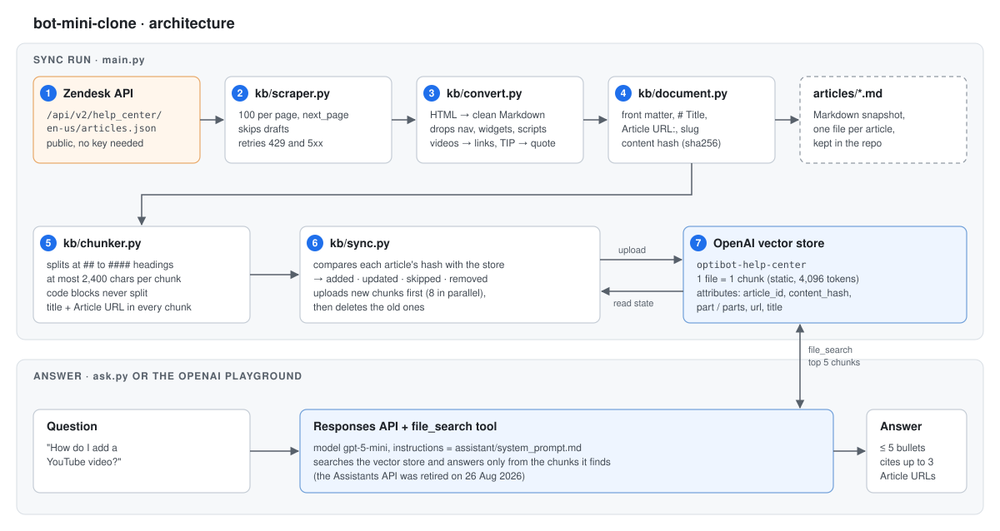
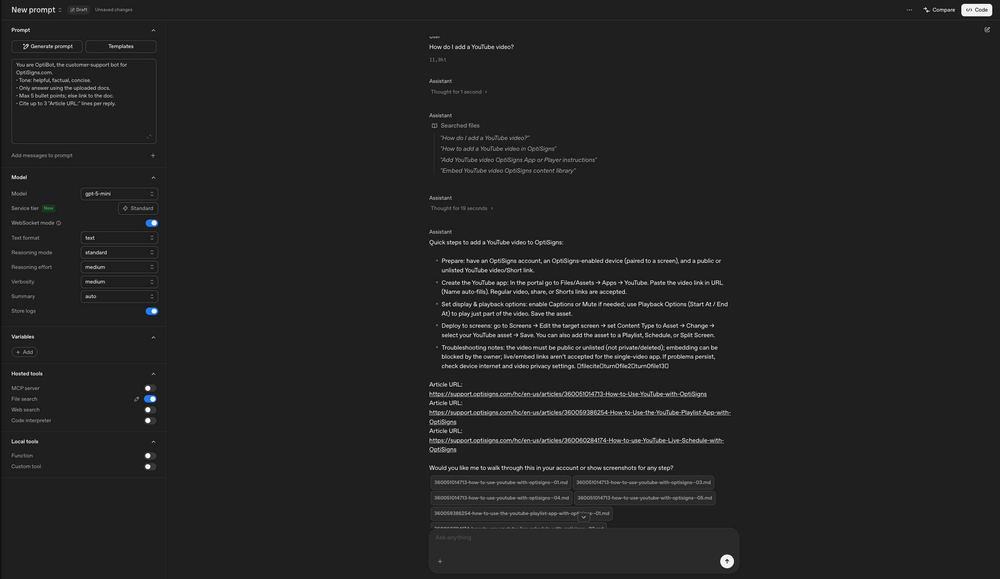

# bot-mini-clone

Scrapes the OptiSigns help center into clean Markdown, loads it into an OpenAI vector store through the API, and keeps it current with a daily job that uploads only what changed. OptiBot answers from that store, with citations.

## Run with Docker

```bash
docker build -t bot-mini-clone .
docker run --rm -e API_KEY=sk-... bot-mini-clone main.py              # one sync run, exits 0
docker run --rm -e API_KEY=sk-... bot-mini-clone ask.py "How do I add a YouTube video?"
docker run --rm -v "$PWD/articles:/app/articles" bot-mini-clone main.py --scrape-only   # Markdown only, no key
```

## Run locally (Python 3.10+, tested on 3.13)

```bash
python3 -m venv .venv && source .venv/bin/activate
pip install -r requirements-dev.txt
cp .env.sample .env                      # set API_KEY (OpenAI)
python main.py --scrape-only             # Markdown into ./articles
python main.py                           # scrape + sync the delta (--limit N for a quick partial run)
python ask.py "How do I add a YouTube video?"
pytest                                   # 74 tests, offline, against a fake Zendesk API and an in-memory OpenAI client
```

## How it works



- **Scrape** ([`kb/scraper.py`](kb/scraper.py), [`kb/convert.py`](kb/convert.py)). The Zendesk Help Center API (`/api/v2/help_center/en-us/articles.json`, 100 per page, `next_page` followed, drafts skipped, retries on 429/5xx) returns each article body without site chrome. It becomes Markdown with headings, lists, tables, images, fenced code (with its language) and links; relative links stay relative. Embedded videos become links, Zendesk TIP/NOTE tables become blockquotes, HTML shown as text is escaped, and base64 images, empty blocks and vote/share widgets are dropped. Each file, `articles/<article-id>-<slug>.md`, starts with front matter, `# Title` and an `Article URL:` line.
- **Chunking** ([`kb/chunker.py`](kb/chunker.py)). Articles are split at `##`–`####` headings and packed into chunks of at most 2,400 characters (438 tokens on average, 1,129 at most in the current data): one topic per chunk, never splitting a code block; oversized lists and tables split between lines. Every chunk repeats the title and `Article URL:`, so any retrieved chunk can be cited. Each chunk is uploaded as its own file with a static strategy of 4,096 tokens (the maximum), more than 2,400 characters can take even at one character per token, so **one file is exactly one embedded chunk** and the logged chunk count is exact.
- **Delta** ([`kb/sync.py`](kb/sync.py)). Each chunk file carries `article_id`, a content hash, `part`/`parts`, URL and title as vector-store attributes, so the store itself is the job's state: no database or volume. A run compares hashes and logs `added`, `updated` (new chunks first, then old ones deleted, so answers never go missing), `skipped`, `removed` (unpublished articles, full runs only), files uploaded and chunks embedded. Failed, missing or mixed-version chunks are re-uploaded on the next run. Exit code 1 if any chunk failed; the summary is the last log line and `articles/last_run.json`.
- **Assistant** ([`ask.py`](ask.py)). System prompt: [`assistant/system_prompt.md`](assistant/system_prompt.md), verbatim. The Assistants API was retired on 26 Aug 2026, so OptiBot runs on the Responses API with the `file_search` tool over the same vector store, in the Playground and in `ask.py`.

## Daily job

GitHub Actions ([`daily-sync.yml`](.github/workflows/daily-sync.yml)) builds the image and runs `docker run -e API_KEY ... main.py` every day at 02:17 UTC, or on demand with "Run workflow". The key is the `OPENAI_API_KEY` repository secret. [`tests.yml`](.github/workflows/tests.yml) runs the tests and the Docker build on every push.

- **Job logs:** [all daily runs](https://github.com/seawish369/bot-mini-clone/actions/workflows/daily-sync.yml) · [run #1](https://github.com/seawish369/bot-mini-clone/actions/runs/41903004969). Each run page shows a summary table and keeps `last_run.json` as an artifact (GitHub shows both to signed-in users).
- **Observed:** 403 published articles → 1,354 chunks from 1,354 files. The first full run replaced an earlier version of the store (updated 403, removed 14 unpublished, failed 0); runs with no changes skip all 403 and upload nothing in about 30 s. A later run picked up real edits on the help center: 3 updated, 398 skipped, 2 removed, 14 files uploaded ([`last_run.json`](articles/last_run.json)).
- [`articles/`](articles) is a snapshot of the scraped Markdown, with the last run's [`last_run.json`](articles/last_run.json), so the output can be reviewed without running anything.

## Sample answer

"How do I add a YouTube video?" in the OpenAI Playground, answered from the vector store with cited `Article URL:` lines:


